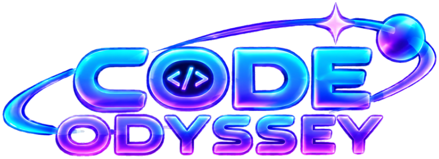

# 🚀 Code Odyssey: CSS Quest Quiz 🌌

  

  
  
  
  

---

## 📖 Introduction

**Code Odyssey: CSS Quest Quiz** is a high-octane, arcade-style mobile quiz game designed to test and sharpen your CSS skills. Built with 100% pure native Android Java and hardware-accelerated Canvas graphics, Code Odyssey immerses players in a glowing cyberpunk cosmos with cinematic hyperspace cutscenes, collectible lucky stars, responsive sound effects, and tiered challenge modes.

Whether you are mastering CSS selectors or fine-tuning Flexbox and Grid, Code Odyssey turns web development trivia into an addictive galactic adventure!

---

## 📥 Download the Game

You can install Code Odyssey directly on any Android device (Android 7.0+ / API 24+):

* 📲 **[Download Code-Odyssey-v1.0.apk (Direct APK Download)](https://github.com/biarzxc1/code-edyssey-sourcecode/releases/download/v1.0.0/Code-Odyssey-v1.0.apk)**
* 📦 **[Download Code-Odyssey-v1.0.aab (Google Play Bundle)](https://github.com/biarzxc1/code-edyssey-sourcecode/releases/download/v1.0.0/Code-Odyssey-v1.0.aab)**
* 🏷️ **[View GitHub Releases](https://github.com/biarzxc1/code-edyssey-sourcecode/releases/tag/v1.0.0)**

---

## ✨ Features & Highlights

### 🎬 1. Cinematic Launch Cutscene (QuizCutsceneView)
- **Iris Reveal**: Smooth circular expand effect originating directly from the tapped button.
- **Hyperspace Warp**: 3D starfield acceleration simulating light-speed travel.
- **Dynamic 3-2-1 Countdown**: Synchronized countdown with tactile haptic pulses and tick sounds.
- **Cosmic Impact FX**: Screen flash, shockwave rings, speed lines, and colorful celebratory confetti.
- **5 Collectible Lucky Stars**: Tap floating stars during the cutscene to collect luck (+1 LUCK up to MAX LUCK!).
- **Interactive Sparkles**: Tap anywhere on screen or drag your finger to leave neon particle trails.
- **SKIP & Auto-Continue**: Skip at any point or let the cutscene smoothly segue into the quiz.

### 🎚️ 2. Neon Difficulty Mode Picker (NeonDifficultyPicker)
- **Tiered Modes**:
  - 🟢 **EASY** (Teal) – Foundations, basic selectors, properties, and values.
  - 🟣 **MEDIUM** (Violet) – Box model, positioning, Flexbox, transitions.
  - 🔴 **HARD** (Rose/Red) – Advanced Grid, CSS variables, pseudo-elements, and edge cases.
- **Progression & Locking**: Locked modes shake with error buzzes and explain how to unlock the next tier.
- **Question Isolation**: Strict difficulty segregation ensuring questions added to Easy only appear in Easy.

### 🔊 3. Low-Latency Retro Neon Audio (NeonSound)
- Integrated multi-stream SoundPool engine with zero latency:
  - sfx_click.wav – Tactile button press chirp.
  - sfx_tab.wav – Soft tab and navigation switch blip.
  - sfx_whoosh.wav – Smooth sci-fi panel opening transition.
  - sfx_success.wav – 4-note ascending major arpeggio for correct answers.
  - sfx_error.wav – Dual-tone buzz for wrong answers or locked items.
  - sfx_unlock.wav – Radiant triumph fanfare for achievements.
  - sfx_tick.wav – Sharp resonant countdown tick.
  - sfx_impact.wav – Deep resonant sub-bass boom.
  - sfx_collect.wav – Sparkling coin chime for lucky stars.
  - sfx_launch.wav – Hyperspace warp riser sweep.
- **Background Music**: Nostalgic 8-bit GameBoy BGM track with mute and persistent volume controls.

### 🎮 4. Cyberpunk Vector Controls & Dynamic UI
- **CosmicBackgroundView**: Real-time multi-layered floating cosmic nebula background with particle bursts.
- **NeonQuizButton**: Custom vector neon button featuring squash-and-stretch press, glowing drop shadows, orbiting satellite orb, and animated gloss sweep.
- **NeonBottomNav**: Translucent frosted-glass bottom navigation bar with haptics.
- **PlayerStatsCard**: Player statistics, heart system (5/5 hearts), win streak counter, and highest streak record.
- **NeonAvatarView**: Player avatar with custom photo upload support from your device gallery.

### 🏆 5. Achievements & Player Profile
- 🏆 **CSS Pioneer** – Win your first CSS Quiz match.
- 🔥 **Code On Fire** – Achieve a 3-game win streak.
- ⚡ **CSS Dominator** – Achieve a 5-game win streak.
- 🌌 **Legendary Odyssey** – Achieve an epic 10-game win streak.
- 🛡️ **Command Authority** – Hold Odyssey Administrator privileges.

### 🛡️ 6. Full In-App Admin Panel (AdminPanel)
- **Live Question Bank Manager**: Add, inspect, filter, and delete custom CSS questions for any difficulty.
- **User Management**: View accounts, track scores, streaks, and promote/manage administrator status.
- **Adjustable Quiz Timer**: Configure custom countdown timer limits synced with cloud storage.

---

## 🏗️ Architecture & Tech Stack

`
Code-Odyssey/
├── android/
│   ├── app/
│   │   ├── src/main/java/com/odyssey/game/
│   │   │   ├── MainActivity.java            # Main activity & screen orchestration
│   │   │   ├── QuizCutsceneView.java        # Full-screen "GOOD LUCK" launch cutscene
│   │   │   ├── NeonDifficultyPicker.java    # Neon difficulty selection popup
│   │   │   ├── NeonSound.java               # SoundPool audio engine & SFX manager
│   │   │   ├── NeonQuizButton.java          # Custom vector neon action button
│   │   │   ├── CosmicBackgroundView.java    # Interactive real-time space background
│   │   │   ├── AdminPanel.java              # Admin dashboard & question manager
│   │   │   ├── Profile.java                 # Profile screen, avatars, & achievements
│   │   │   ├── FirebaseHelper.java          # Cloud sync & persistence
│   │   │   └── Question.java / Account.java # Data models
│   │   └── src/main/res/
│   │       ├── raw/                         # Audio files (SFX + BGM)
│   │       ├── font/                        # Custom typography (Poppins, Times)
│   │       └── layout/                      # UI layouts & alert dialogs
│   └── build.gradle.kts                     # Gradle build & signing configuration
├── Code-Odyssey-v1.0.apk                    # Signed release APK
└── Code-Odyssey-v1.0.aab                    # Google Play App Bundle
`

- **Language**: Java 17
- **Target SDK**: Android 14 (API 34)
- **Min SDK**: Android 7.0 (API 24)
- **Audio Architecture**: Android SoundPool + MediaPlayer
- **Graphics**: Hardware-accelerated Custom 2D Canvas views
- **Backend / Persistence**: Firebase Firestore + SharedPreferences offline caching

---

## 🛠️ Building & Running Locally

### Prerequisites
- [Android Studio](https://developer.android.com/studio) (Ladybug / Koala / Hedgehog or newer) OR Android SDK Command-line Tools
- Java Development Kit (JDK 17+)
- Android device or emulator running API 24+

### Build from Terminal

1. **Clone the repository:**
   `ash
   git clone https://github.com/biarzxc1/code-edyssey-sourcecode.git
   cd code-edyssey-sourcecode/android
   `

2. **Assemble Debug APK:**
   `ash
   ./gradlew assembleDebug
   `

3. **Assemble Signed Release APK:**
   `ash
   ./gradlew assembleRelease
   `

4. **Install to Connected Device via ADB:**
   `ash
   adb install -r app/build/outputs/apk/release/app-release.apk
   `

---

## 📄 License & Credits

- Developed for **Code Odyssey**
- BGM Track: *Gameboy* by Walen (Free To Use)
- Typography: Poppins Font Family (SIL Open Font License)
